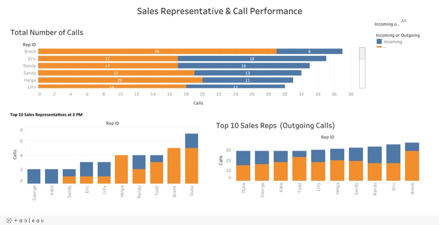
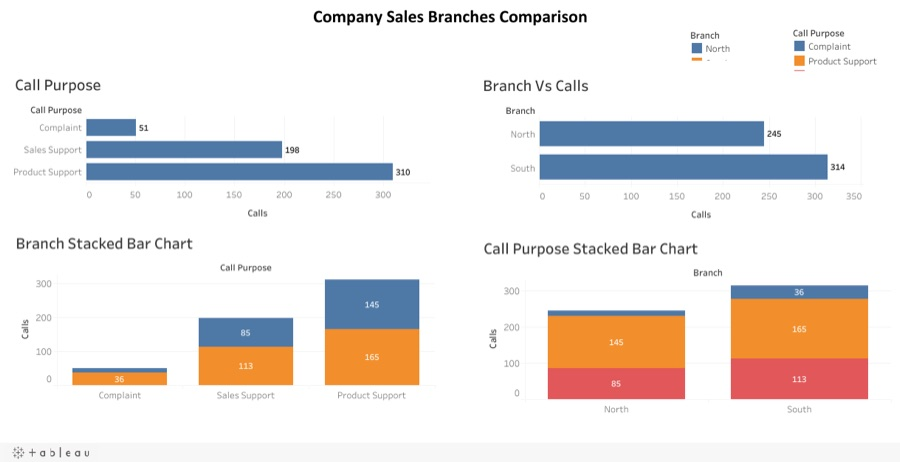

# Telephone Company Tableau Dashboards

Interactive Tableau dashboards exploring call performance by sales representative, branch, and call purpose.

## Dashboards

### Telecom Company Sales Rep & Call Performance Analysis

Review incoming and outgoing calls by representative, compare the top representatives by call volume, and explore the largest outgoing call totals.

[Open the interactive dashboard on Tableau Public](https://public.tableau.com/app/profile/mohammed.rawther/viz/TelecomCompanySalesRepCallPerformanceAnalysis/SalesRepresentativeandCallsPerformance)

### Telecom Company Branch Sales Analysis

Compare call volume across the North and South branches and see how call purpose contributes to each branch's totals. In the published view, South records 314 calls and North records 245; Product Support is the largest call purpose with 310 calls.

[Open the interactive dashboard on Tableau Public](https://public.tableau.com/app/profile/mohammed.rawther/viz/TelecomCompanyBranchSalesAnalysis/CompanySalesBranchesComparison)

## Project files

- [Packaged Tableau workbook](Telecom%20Company%20Branch%20Sales%20Analysis.twbx)
- [Branch comparison export](Company%20Sales%20Branches%20Comparison.pdf)

## Tools

- Tableau Public for publishing and interactive exploration
- Tableau workbook format (.twbx) for the branch analysis source file

## Author

Mohammed Rawther · [Tableau Public profile](https://public.tableau.com/app/profile/mohammed.rawther) · [GitHub](https://github.com/Rawther-007)
